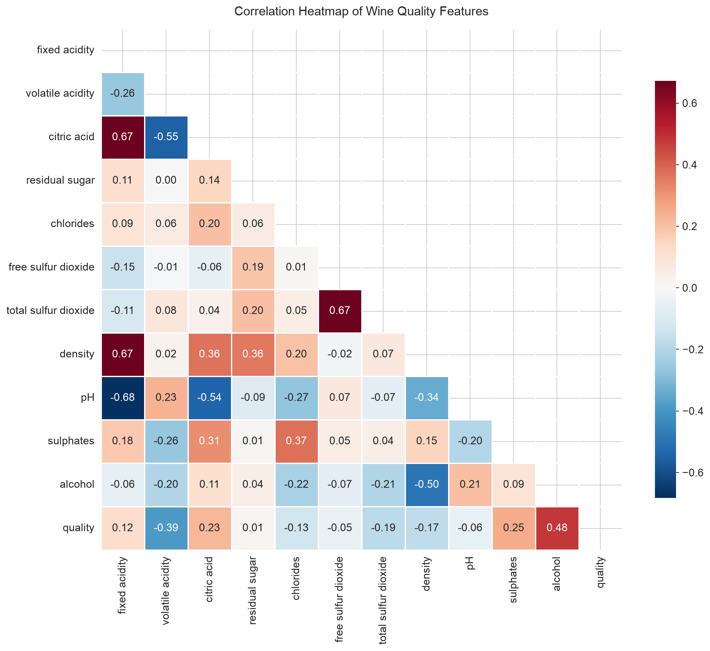
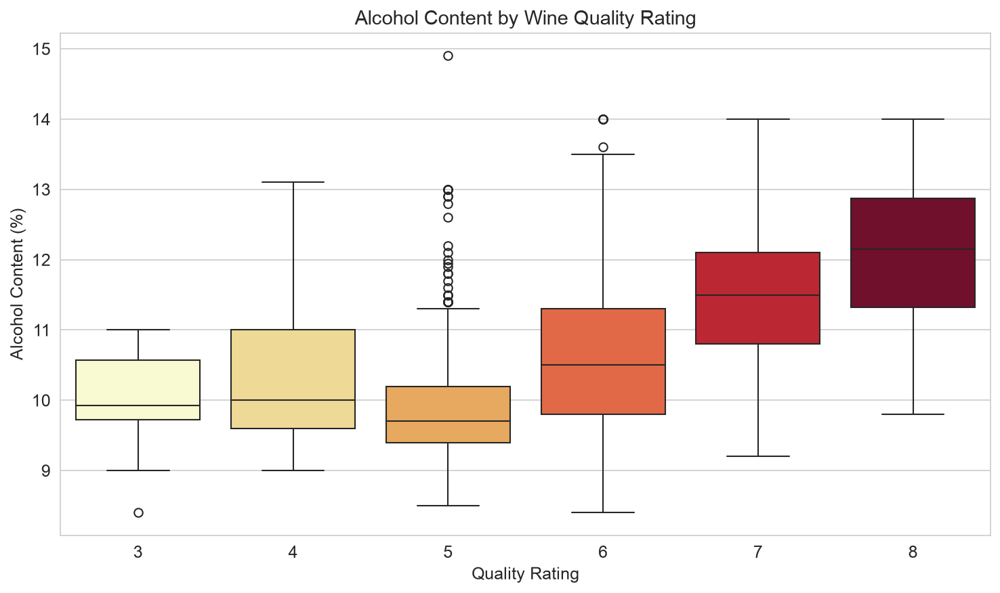
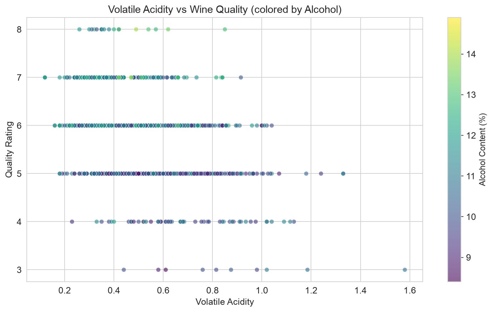

# data-science-project
My data science portfolio for CISC7204 Practice 09
# Wine Quality Analysis: What Factors Affect Red Wine Quality?

## Problem / Research Question
Which physicochemical properties most influence the quality rating of red wine? This project analyzes the relationship between alcohol, volatile acidity, citric acid, sulphates, and other features with the quality score.

## Dataset Source and Usage Permissions
- Source: UCI Machine Learning Repository, Wine Quality Data Set
- Link: https://archive.ics.uci.edu/dataset/186/wine+quality
- File used: winequality-red.csv (1,599 records, 11 chemical features + 1 quality score)
- License: CC BY 4.0, allows sharing and adaptation with attribution
- Citation: Cortez, P., Cerdeira, A., Almeida, F., Matos, T., & Reis, J. (2009). Wine Quality [Dataset]. UCI Machine Learning Repository. https://doi.org/10.24432/C56S3T
- Redistribution: Allowed with attribution. This project does not upload the raw data; it only provides download instructions.

## Methods and Tools
- Language: Python
- Libraries: pandas, NumPy, matplotlib, seaborn, scikit-learn
- Environment: Jupyter Notebook
- Version control: Git / GitHub

Analysis steps:
1. Data cleaning: check missing values, duplicates, outliers.
2. Exploratory data analysis: descriptive statistics, correlation analysis, group comparisons.
3. Visualization: correlation heatmap, boxplot, scatter plot.
4. Interpretation: explain key findings with charts.

## Key Findings and Limitation
Key findings:
1. Alcohol content is positively correlated with quality rating (correlation ≈ 0.48).
2. Volatile acidity is negatively correlated with quality rating (correlation ≈ -0.39).
3. Citric acid and sulphates show weak positive correlations.
4. Total sulfur dioxide has a weak relationship with quality.

Visualizations:




Limitation:
The data only covers Portuguese Vinho Verde red wine, and quality ratings are subjective expert scores. The sample is limited and cannot be generalized to all red wines. Correlation does not imply causation.

## How to Run the Analysis
```bash
git clone https://github.com/<your-username>/data-science-project.git
cd data-science-project
python -m venv .venv
source .venv/bin/activate   # Windows: .venv\Scripts\activate
pip install -r requirements.txt
