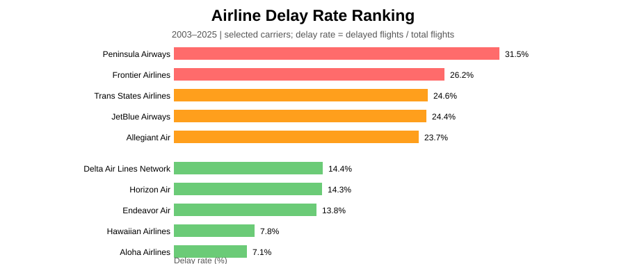
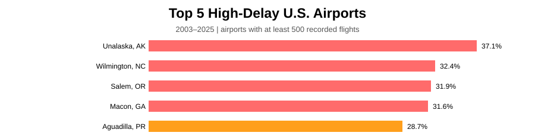
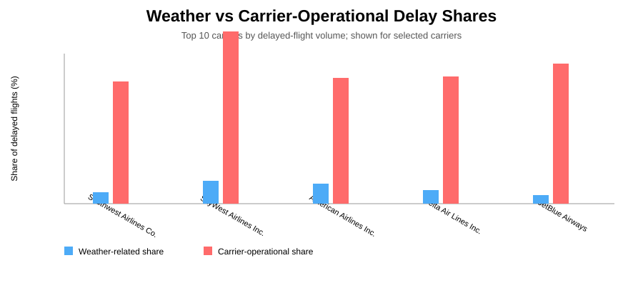
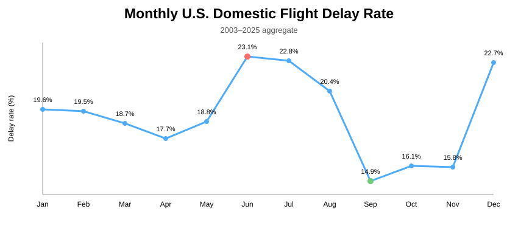

# U.S. Domestic Flight Delay Pattern Analysis

## Research question
What drives U.S. domestic flight delays — carriers, airports, time of year, or causal factors — and how can travelers, airlines, and policy makers use these insights to improve on-time performance?

## Dataset source and usage permissions
- **Official source:** U.S. Bureau of Transportation Statistics (BTS), TranStats On-Time Performance data: https://www.transtats.bts.gov/
- **Convenient mirror used to prepare this project:** https://www.kaggle.com/datasets/daryaheyko/airline-on-time-statistics-and-delay-causes-bts
- **Coverage:** 398,233 aggregated records from June 2003 to January 2025, representing more than 140 million domestic U.S. flights.
- **Fields used:** year, month, carrier, carrier name, airport, airport name, arrived flights, delayed flights, carrier-caused delays, and weather-caused delays.
- **Usage:** the data is public statistical data, but users must follow the usage terms displayed by BTS/Kaggle and retain attribution. No passwords, API keys, personal data, or restricted datasets are included in this repository. The raw 38 MB CSV is intentionally not committed; see `data/README.md`.

## Repository layout
```text
data-science-project/
├── README.md
├── index.md                         # GitHub Pages portfolio entry
├── analysis.py                      # Reproducible analysis script
├── requirements.txt
├── .gitignore
├── CITATION.md
├── notebooks/
│   ├── flight_delay_analysis.ipynb  # Notebook entry point
│   └── README.md
├── images/
│   ├── carrier_delay_ranking.svg
│   ├── top_delay_airports.svg
│   ├── weather_vs_carrier.svg
│   └── monthly_trend.svg
├── data/
│   └── README.md                    # Dataset download and placement guide
└── docs/
    ├── proposal_summary.md
    ├── peer_feedback.md
    ├── reflection.md
    ├── submission.md
    └── rubric_checklist.md
```

## Methods and tools
- **Tools:** Python, Jupyter Notebook, pandas, NumPy, Matplotlib, and Seaborn.
- **Data preparation:** checked missing values; filled non-operating/unreported numeric delay fields with zero; converted numeric fields where needed.
- **Metrics:** delay rate, carrier-operational delay share, weather delay share, and minimum-sample filters to reduce small-group volatility.
- **Analysis dimensions:** carrier (`who`), airport (`where`), month (`when`), and cause (`why`).
- **Reproducibility:** `analysis.py` loads the CSV from `data/` and writes figures to `images/`. The notebook in `notebooks/` runs the same script.

## Key findings supported by the analysis
1. The overall delay rate is **19.2%**, or roughly one delayed flight in five.
2. Across all carriers, **Aloha Airlines has the lowest delay rate at about 7.1%**, while **Peninsula Airways has the highest at about 31.5%**. Among carriers with more than 10,000 recorded flights, Frontier Airlines is highest at about **26.2%**.
3. Airport risk is concentrated in smaller or weather-exposed locations; **Unalaska has the highest airport delay rate at about 37.1%** among airports with at least 500 flights.
4. Airline operations are the largest clearly identified delay cause at about **29.5%** of delayed flights, while direct weather delays account for about **3.6%**; the remaining share is grouped into other/systemic causes.
5. Delay risk is seasonal: **June is the worst month at about 23.1%**, while **September is the best month at about 14.9%**.

## Visualizations








## Limitation
The dataset is aggregated by carrier, airport, and month. It supports pattern discovery and ranking, but it cannot prove passenger-level causality, explain every operational mechanism behind “other” delays, or capture schedule-quality differences such as buffer time and aircraft rotation. Results are historical and may not generalize to future schedules, airline mergers, or changed weather patterns.

## How to reproduce
1. Clone the repository:
   ```bash
   git clone https://github.com/mc636011/data-science-project.git
   cd data-science-project
   ```
2. Create and activate a virtual environment:
   ```bash
   python -m venv .venv
   source .venv/bin/activate        # Windows Git Bash: source .venv/Scripts/activate
   ```
3. Install dependencies:
   ```bash
   pip install -r requirements.txt
   ```
4. Download the CSV and place it at:
   ```text
   data/Airline_Delay_Cause-selected-columns.csv
   ```
   Detailed download options are in `data/README.md`.
5. Run the analysis:
   ```bash
   python analysis.py
   ```
   Or launch `jupyter notebook notebooks/flight_delay_analysis.ipynb` and run the notebook entry point.
6. The script reads `data/Airline_Delay_Cause-selected-columns.csv` and writes figures into `images/`.

## Project status
Completed for the CISC7204 Data Science Portfolio.
