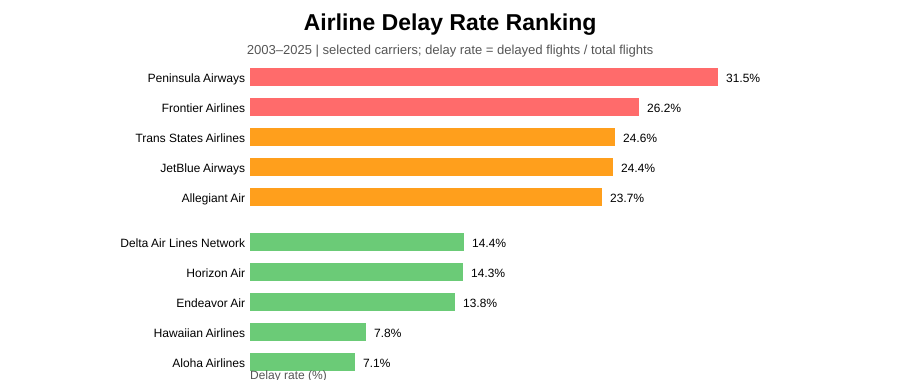

# WANG YU MENG (MC636011) — Data Science Portfolio

## About me
I am developing practical skills in Python data analysis, reproducible research, visualization, and technical communication. My project work focuses on turning a clear research question into documented code, readable charts, and evidence-based recommendations.

## Technical skills
- Python, pandas, NumPy, and Jupyter Notebook
- Data cleaning, aggregation, feature engineering, and exploratory analysis
- Matplotlib and Seaborn visualization
- Git, GitHub, GitHub Pages, and technical documentation

## Featured project: U.S. Domestic Flight Delay Pattern Analysis

### Research question
What drives U.S. domestic flight delays — carriers, airports, time of year, or causal factors?

### Approach
I used BTS airline on-time data covering June 2003 to January 2025. After cleaning missing operational values and calculating delay-rate metrics, I compared carriers, airports, months, and causal factors. The analysis code is available in the project repository.

### Findings
- Overall delay rate: **19.2%**.
- Best-performing carrier: **Aloha Airlines, 7.1%**.
- Highest overall carrier delay rate: **Peninsula Airways, 31.5%**; among carriers with more than 10,000 flights, Frontier Airlines is highest at **26.2%**.
- Highest-delay airport: **Unalaska, 37.1%**.
- Carrier-operational issues account for about **29.5%** of delays, while direct weather delays account for about **3.6%**.
- **September** is the most reliable month (**14.9%**) and **June** is the least reliable (**23.1%**).

### Visualization

### Limitation
The analysis uses monthly aggregated records, so it shows associations and rankings rather than proving passenger-level causality. Historical delay patterns also may not generalize to future airline schedules or weather conditions.

### Project repository
[View the code, data instructions, and documentation](https://github.com/mc636011/data-science-project)

### Status
Completed
