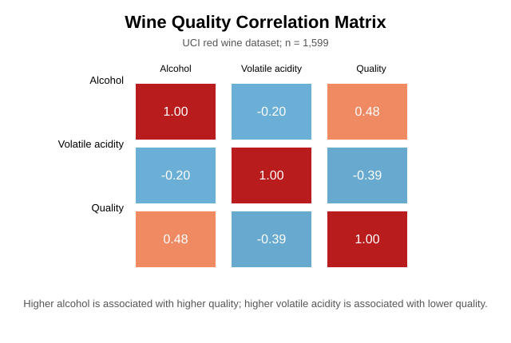
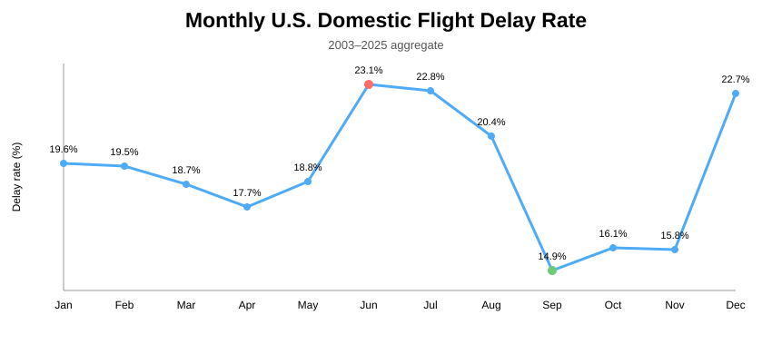
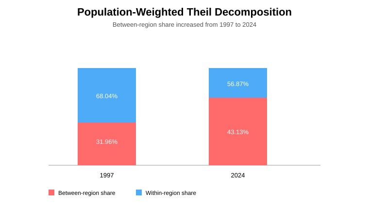

# WANG YU MENG (MC636011) — Data Science Portfolio

## About me
I am developing practical skills in Python data analysis, reproducible research, visualization, and technical communication. This portfolio separates my individual project from two group assignments so the contribution context is clear.

## Technical skills
- Python, pandas, NumPy, and Jupyter Notebook workflows
- Data cleaning, aggregation, exploratory analysis, and statistical summaries
- Matplotlib and Seaborn visualization
- Git, GitHub, GitHub Pages, and reproducible documentation

## Individual work

### Wine Quality Analysis
**Folder:** [projects/personal-wine-quality](projects/personal-wine-quality)  
**Research question:** Which physicochemical properties most influence red wine quality?

**Key findings:** Alcohol is positively correlated with quality at approximately **0.48**, while volatile acidity is negatively correlated at approximately **-0.39**. Mean alcohol rises from **9.96%** for quality 3 wine to **12.09%** for quality 8 wine.

**Limitation:** The sample covers Portuguese Vinho Verde red wine and uses subjective expert quality scores, so the findings do not generalize to all wines.

**Status:** Completed

## Group Assignment 01

### U.S. Domestic Flight Delay Pattern Analysis
**Folder:** [projects/assignment01-flight-delay](projects/assignment01-flight-delay)  
**Team:** MC636087 ZHOU ZHUO; MC636011 WANG YU MENG  
**Research question:** What drives U.S. domestic flight delays — carriers, airports, time of year, or causal factors?

**Key findings:** The overall delay rate is about **19.2%**. Aloha Airlines has the lowest delay rate at about **7.1%**, while Peninsula Airways has the highest overall rate at about **31.5%**. June is the worst month at **23.1%**, while September is best at **14.9%**.

**Limitation:** The data is aggregated by carrier, airport, and month, so it cannot prove passenger-level causality.

**Status:** Completed

## Group Assignment 02

### Income Inequality Across UK Local Authorities
**Folder:** [projects/assignment02-income-inequality](projects/assignment02-income-inequality)  
**Team:** MC636087 ZHOU ZHUO; MC636011 WANG YU MENG  
**Research question:** Is GDHI per head across UK local authorities converging or diverging between 1997 and 2024, and which components drive regional differences in 2024?

**Key findings:** Equal-weighted CV declines from **0.4497 in 1997** to **0.3551 in 2024**, but population-weighted Theil rises from **0.0278** to **0.0388**. London has the largest within-region dispersion, with CV about **0.551** in 2024.

**Limitation:** The analysis uses aggregate local-authority GDHI rather than individual household income, and population weighting changes the convergence conclusion.

**Status:** Completed

## Project repository
[View the full repository](https://github.com/mc636011/data-science-project)
